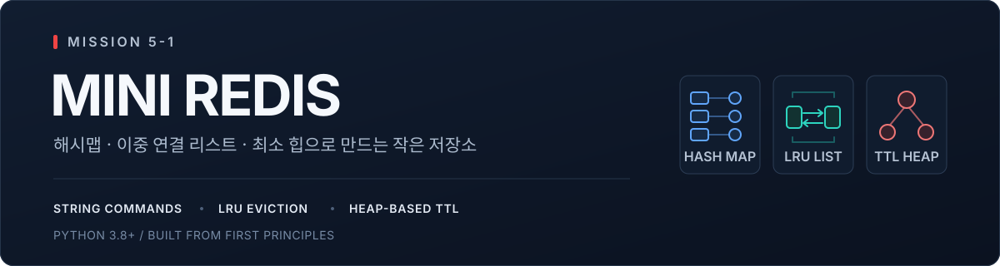
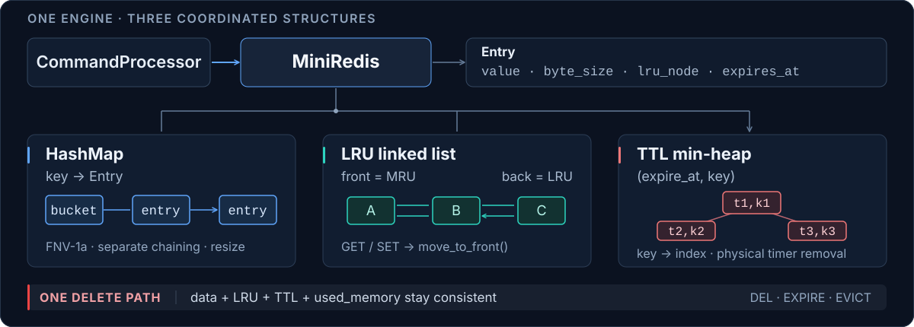

<p align="center">
  
</p>

# MISSION 5-1 · Mini Redis

[Python 3.8 · 3.13 검증 성공](https://github.com/tjdgns6427-ops/MISSION-5-1/actions/runs/41049218279) · [현재 CI 상태](https://github.com/tjdgns6427-ops/MISSION-5-1/actions/workflows/tests.yml)

**키를 찾는 해시맵, 사용 순서를 기억하는 이중 연결 리스트, 가장 빠른 만료를 찾는 최소 힙.**

세 자료구조를 직접 구현하고 하나의 CLI 저장소로 연결했습니다. 총 10개 명령어, UTF-8 바이트 기준 메모리 제한, LRU 자동 제거, TTL 만료를 지원합니다. 저장소와 캐시 구현에는 `dict`, `set`, `collections`, `heapq`를 사용하지 않습니다.

| 실행 환경 | 검증 | 추가 구현 |
| :--- | :--- | :--- |
| Python **3.8 이상** · 외부 패키지 없음 | **85개 테스트** · Python 3.8 / 3.13 CI 통과 | 동적 배열 · 키별 위치를 추적하는 TTL 힙 |

[빠른 시작](#빠른-시작) · [동작 시연](#동작-시연) · [설계](#설계) · [명령어](#명령어) · [테스트](#테스트) · [코드 안내](#코드-안내)

## 빠른 시작

저장소를 내려받고 폴더 안에서 실행합니다. 패키지 설치나 Redis 서버가 필요하지 않습니다.

```bash
git clone https://github.com/tjdgns6427-ops/MISSION-5-1.git
cd MISSION-5-1
python -m mini_redis
```

```text
mini-redis> SET name "Alice Smith"
OK
mini-redis> GET name
"Alice Smith"
mini-redis> EXISTS name
(integer) 1
mini-redis> DEL name
(integer) 1
mini-redis> GET name
(nil)
mini-redis> quit
```

`python main.py`로도 실행할 수 있습니다. Windows에서 `python` 명령이 등록되어 있지 않다면 `py -3 -m mini_redis`를 사용합니다. `exit`, `quit`, EOF, `Ctrl+C`로 종료합니다. 명령어는 대소문자를 구분하지 않고, 키와 값은 구분합니다.

## 동작 시연

### 1. 메모리 제한을 넘으면 가장 오래 사용하지 않은 키를 제거

```text
mini-redis> CONFIG SET maxmemory 30
OK
mini-redis> SET user:1 "Alice"
OK
mini-redis> SET user:2 "Bob"
OK
mini-redis> SET user:3 "Charlie"
OK
mini-redis> GET user:1
(nil)
mini-redis> INFO memory
used_memory:22
maxmemory:30
evicted_keys:1
```

| 저장 항목 | 키 바이트 | 값 바이트 | 합계 |
| :--- | ---: | ---: | ---: |
| `user:1` → `Alice` | 6 | 5 | 11 |
| `user:2` → `Bob` | 6 | 3 | 9 |
| `user:3` → `Charlie` | 6 | 7 | 13 |

세 항목의 합은 **33바이트**입니다. 마지막 `SET` 직후 `user:1`이 LRU이므로 11바이트를 제거하고 **22바이트**를 유지합니다. 성공한 `GET`도 최근 사용 순서를 바꿉니다.

```text
                          최근 사용(MRU) → 오래된 사용(LRU)
SET user:3 이후           user:3 → user:2        user:1 제거
GET user:2 이후           user:2 → user:3
SET user:4 "Dave" 이후    user:4 → user:2        user:3 제거
```

마지막 단계에서는 22 + 10 = 32바이트가 되어 `user:3`의 13바이트를 제거합니다. 결과는 `used_memory:19`, `evicted_keys:2`입니다. `EXISTS`, `TTL`, `KEYS` 같은 조회는 최근 사용 순서를 바꾸지 않습니다.

### 2. 시간이 지나면 TTL이 있는 키를 만료 처리

아래는 주입한 시계를 사용한 재현 결과입니다. 처음 시각을 100초로 고정하고 `EXPIRE` 후 정확히 3초를 이동합니다.

```text
mini-redis> SET session token
OK
mini-redis> EXPIRE session 3
(integer) 1
mini-redis> TTL session
(integer) 3

# 시계를 3초 진행
mini-redis> GET session
(nil)
mini-redis> TTL session
(integer) -2
mini-redis> DBSIZE
(integer) 0
```

두 시나리오는 [실행 가능한 데모](examples/demo.py)로 제공합니다. 실제 명령 처리기를 호출하고 예상 응답과 비교하므로 출력이 달라지면 실패합니다. 별도의 대기 없이 실행됩니다.

```bash
python -m examples.demo
```

일반 REPL에서는 실제 시간이 흐르므로 `EXPIRE key 3` 직후 `TTL key`가 `2`로 보일 수 있습니다. 남은 시간은 초 단위로 내림하며, 아직 만료되지 않았지만 1초 미만 남은 키는 `0`을 반환합니다.

## 설계

<p align="center">
  
</p>

[구조도 원본 보기](docs/assets/architecture.svg)

### 해시맵: 키가 저장된 위치를 찾기

[HashMap](mini_redis/structures/hash_map.py)은 문자열을 UTF-8 바이트로 변환하고, **64비트 FNV-1a 알고리즘을 직접 구현한 해시 함수**로 버킷 위치를 계산합니다. 같은 버킷에 들어간 키들은 이중 연결 리스트로 체이닝합니다. 로드 팩터가 **0.75를 초과하면 버킷을 2배로 확장**하고 모든 항목을 다시 배치합니다.

평균 조회 비용은 O(1)입니다. 모든 키가 같은 버킷에 몰리는 경우에는 체인을 순회하므로 O(n)이며, 해시 계산에는 키 길이에 비례하는 비용이 듭니다.

### LRU: 키를 찾은 뒤 리스트를 다시 탐색하지 않기

데이터 해시맵의 `Entry`는 값과 함께 **자신의 LRU 노드를 직접 참조**합니다. `GET`에 성공하면 그 노드를 떼어 리스트 맨 앞으로 옮깁니다. 메모리가 부족하면 맨 뒤 노드의 키를 제거합니다.

[DoublyLinkedList](mini_redis/structures/linked_list.py)는 양 끝 노드와 각 노드의 `prev`, `next`를 유지합니다. 따라서 앞·뒤 삽입, 삭제, 알려진 노드의 이동은 탐색 없이 **O(1)** 시간에 끝납니다. 키를 찾는 비용과 TTL 힙을 정리하는 비용은 별도입니다.

### TTL: 다음으로 만료될 키부터 확인하기

[MinHeap](mini_redis/structures/min_heap.py)은 `(expire_at, key)`를 저장합니다. 루트에는 가장 빠른 만료가 있으므로 전체 키를 순회하지 않고 다음 만료를 O(1)에 확인합니다. 저장소 작업을 시작할 때 루트가 만료된 동안 계속 제거하고, 미래의 만료를 만나면 멈춥니다.

키별 힙 위치를 별도의 사용자 정의 해시맵으로 추적합니다. `EXPIRE` 재호출은 기존 항목을 갱신하고, `DEL`·`SET`·LRU 제거는 타이머를 실제로 지웁니다. **TTL이 있는 키 하나당 힙 항목 하나**를 유지하므로 과거 타이머가 누적되지 않습니다.

시계는 `time.monotonic()`을 사용하고, 내부 만료 시각은 정수 나노초로 계산합니다. 시스템 날짜 변경의 영향을 피하면서 큰 정수 기간을 더할 때의 반올림도 방지합니다. 별도 스레드 없이 명령 실행 시점에 만료를 정리합니다.

### 메모리: 모든 삭제 경로에서 같은 값을 유지하기

```text
used_memory = Σ (len(key.encode("utf-8")) + len(value.encode("utf-8")))
```

문자 수가 아니라 **UTF-8 바이트 수**를 셉니다. 예를 들어 `SET 한 글`은 키 3바이트와 값 3바이트로 총 6바이트입니다. 노드·포인터·버킷 등의 객체 오버헤드는 과제 공식에 따라 제외하므로 `used_memory`는 프로세스의 실제 메모리 사용량과 다릅니다.

[MiniRedis._remove_entry](mini_redis/store.py)는 사용자 삭제, TTL 만료, LRU 제거에서 공통으로 호출됩니다. 데이터 해시맵, LRU 노드, TTL 타이머를 함께 제거하고 `used_memory`를 한 번만 차감합니다. `evicted_keys`는 LRU로 제거했을 때만 증가합니다.

### 복잡도와 적용 조건

`n`은 저장된 키 수, `t`는 TTL이 있는 키 수, `b`는 해시 버킷 수입니다. 아래 비용은 문자열 길이와 한 번에 처리할 만료 개수를 별도로 둔 평균 또는 분할 상환 비용입니다.

| 연산 | 비용 | 조건 |
| :--- | :--- | :--- |
| 해시맵 조회·삽입·삭제 | 평균 O(1), 최악 O(n) | 확장 비용은 분할 상환 |
| LRU 노드 삽입·삭제·이동 | O(1) | 노드를 직접 참조 |
| 다음 만료 확인 | O(1) | 최소 힙 루트 조회 |
| TTL 삽입·변경·삭제 | 평균 분할 상환 O(log(t + 1)) | 위치 해시맵과 동적 배열 사용 |
| 만료된 키 `k`개 정리 | 평균 O(k log(t + 1)) 상한 | 각 명령 앞에 추가되는 비용 |
| `KEYS` | O(n + b) | 버킷 배열은 축소하지 않음 |
| `DBSIZE`, `INFO memory` 본체 | O(1) | 만료 정리 후 유지 중인 카운터 읽기 |

`SET`은 여러 키를 연속 제거할 수 있고, TTL이 있는 키를 삭제하면 힙 정리도 수행합니다. 따라서 명령 전체를 항상 O(1)이라고 보장하지 않습니다. 해시 계산·UTF-8 변환·파싱·출력에는 각 문자열 길이에 비례하는 비용도 추가됩니다.

## 명령어

| 명령어 | 정상 응답 | 주요 규칙 |
| :--- | :--- | :--- |
| `SET key value` | `OK` | 최근 사용으로 이동, 기존 TTL 초기화 |
| `GET key` | `"value"` 또는 `(nil)` | 조회 성공 시에만 LRU 갱신 |
| `DEL key` | `(integer) 1` / `(integer) 0` | 데이터·LRU·TTL 모두 제거 |
| `EXISTS key` | `(integer) 1` / `(integer) 0` | LRU 순서 유지 |
| `DBSIZE` | `(integer) N` | 만료된 키를 제외한 개수 |
| `KEYS` | `1) "key"` 형식의 배열 | 빈 결과는 `(empty array)`, 순서 미지정 |
| `CONFIG SET maxmemory bytes` | `OK` | 0 이상, `0`은 무제한, 상한 축소 시 즉시 LRU 적용 |
| `INFO memory` | 사용량·상한·누적 제거 수 | `used_memory`, `maxmemory`, `evicted_keys` |
| `EXPIRE key seconds` | `(integer) 1` / `(integer) 0` | 없는 키는 0, 기간이 0 이하면 즉시 삭제 |
| `TTL key` | `(integer) N` | 만료 미설정은 -1, 없는 키는 -2 |

공백이나 빈 문자열은 `SET name "Alice Smith"`, `SET empty ""`처럼 큰따옴표로 감쌉니다. 숫자 인수는 부호를 허용하는 64비트 정수이며 `maxmemory`는 음수를 허용하지 않습니다. `DEL`·`EXISTS` 등은 표에 표시된 단일 키 형식만 지원하고, `KEYS`의 패턴 매칭은 지원하지 않습니다.

### 오류와 경계 조건

```text
mini-redis> HELLO
(error) ERR unknown command 'HELLO'
mini-redis> GET
(error) ERR wrong number of arguments for 'GET' command
mini-redis> CONFIG SET maxmemory abc
(error) ERR value is not an integer or out of range
mini-redis> CONFIG SET maxmemory 1
OK
mini-redis> SET key value
(error) OOM command not allowed when used_memory > 'maxmemory'
```

잘못된 입력을 처리한 뒤에도 REPL은 다음 명령을 받습니다. 닫히지 않은 따옴표는 구문 오류로 처리합니다.

| 상황 | 처리 |
| :--- | :--- |
| 단일 키·값의 크기가 메모리 상한 초과 | OOM. 기존 값·TTL·LRU 유지. 이미 만료된 키의 정리는 수행 |
| 기존 키에 `SET` 성공 | 이전 바이트 수를 빼고 새 크기 반영, 기존 TTL 제거 |
| 만료된 키에 `GET` | 먼저 삭제하고 `(nil)`. LRU 갱신 없음 |
| `DEL` 후 같은 키 재사용 | 이전 타이머가 제거되어 새 값에 영향 없음 |
| `EXPIRE`로 기간 재설정 | 힙의 기존 항목을 갱신하여 타이머 중복 방지 |
| 상한을 `0`으로 변경 | 무제한으로 전환, 추가 제거 없음 |

## 테스트

```bash
python -m unittest discover -s tests -v
python -m examples.demo
```

**85개 자동 테스트**가 자료구조부터 실제 프로세스로 실행한 CLI까지 검증합니다. Windows의 로컬 실행과 Ubuntu의 GitHub Actions에서 확인했으며, CI는 Python **3.8 / 3.13**에서 각각 실행합니다.

| 검증 범위 | 확인하는 문제 | 테스트 |
| :--- | :--- | :--- |
| 자료구조 | 해시 충돌·재해싱, 링크 연결, 힙 갱신·삭제, 동적 배열 확장 | [test_structures.py](tests/test_structures.py) |
| 저장소 | LRU 순서, UTF-8 집계, OOM 상태 보존, 만료 경계와 재삽입 | [test_store.py](tests/test_store.py) |
| 명령 처리 | 출력 형식, 따옴표, 잘못된 인수, 정수 범위 | [test_commands.py](tests/test_commands.py) |
| CLI | 프롬프트, 파이프, EOF, 종료 명령, 오류 후 계속 실행 | [test_cli.py](tests/test_cli.py) |
| 구현 제약 | 금지 컬렉션·대체 라이브러리 미사용, 독립 모듈, Python 3.8 구문 | [test_constraints.py](tests/test_constraints.py) |

만료 테스트는 주입한 시계를 사용해 경계 시각을 정확히 재현합니다. 힙의 무작위 갱신·삭제는 정렬된 참조 결과와 비교하고, 금지 컬렉션 사용 여부는 AST로 검사합니다.

[실제 CI 성공 기록](https://github.com/tjdgns6427-ops/MISSION-5-1/actions/runs/41049218279) · [현재 워크플로 상태](https://github.com/tjdgns6427-ops/MISSION-5-1/actions/workflows/tests.yml) · [검증 환경과 결과](docs/TEST_RESULTS.md)

## 코드 안내

```text
MISSION-5-1/
├── main.py                      # 직접 실행 진입점
├── mini_redis/
│   ├── __main__.py               # python -m mini_redis 진입점
│   ├── cli.py                    # REPL 입출력
│   ├── commands.py               # 파싱·검증·Redis 스타일 응답
│   ├── store.py                  # 저장소·LRU·TTL·메모리 정책
│   └── structures/
│       ├── dynamic_array.py      # 인덱스 저장 공간과 2배 확장
│       ├── linked_list.py        # 체이닝과 LRU에서 재사용
│       ├── hash_map.py           # FNV-1a와 체이닝
│       └── min_heap.py           # 키별 위치를 추적하는 TTL 힙
├── examples/demo.py              # 기대 응답을 검증하는 실행 시연
├── tests/                        # 85개 자동 테스트
├── docs/                         # 상세 설계·요구사항·검증 기록
└── .github/workflows/tests.yml   # Python 3.8 / 3.13 CI
```

코드를 읽는 순서는 [명령 처리](mini_redis/commands.py) → [저장소 정책](mini_redis/store.py) → [자료구조](mini_redis/structures/)가 적합합니다. 자료구조 구현을 따로 살펴보려면 동적 배열 → 연결 리스트 → 해시맵 → 최소 힙 순으로 읽을 수 있습니다.

| 문서 | 내용 |
| :--- | :--- |
| [ARCHITECTURE](docs/ARCHITECTURE.md) | 해시 함수, 포인터 조작, 힙 위치 갱신, 메모리·만료 처리의 상세 설명 |
| [REQUIREMENTS](docs/REQUIREMENTS.md) | 과제 요구사항별 구현 위치와 확인 방법 |
| [STACK_QUEUE_DEQUE](docs/STACK_QUEUE_DEQUE.md) | 보너스: 스택·큐·덱의 차이와 연결 리스트 활용 |
| [TEST_RESULTS](docs/TEST_RESULTS.md) | 실행 환경, 검증 범위, 원격 테스트 성공 기록 |

동적 배열은 보너스 구현으로, 해시맵 버킷과 힙의 내부 저장소에서 실제로 사용합니다. Python 리스트는 이 배열의 고정 크기 공간과 명령·결과 전달에 사용합니다. 이 프로젝트의 범위는 단일 프로세스의 문자열 CLI 저장소이며, 네트워크 통신·파일 영속성·동시성·Redis 복합 자료형은 포함하지 않습니다. 선택 과제인 이진 트리·BST·Pub/Sub도 구현 범위에 포함하지 않았습니다.
